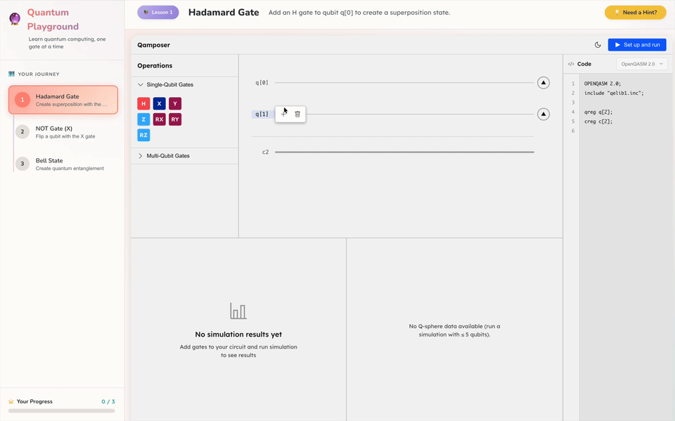
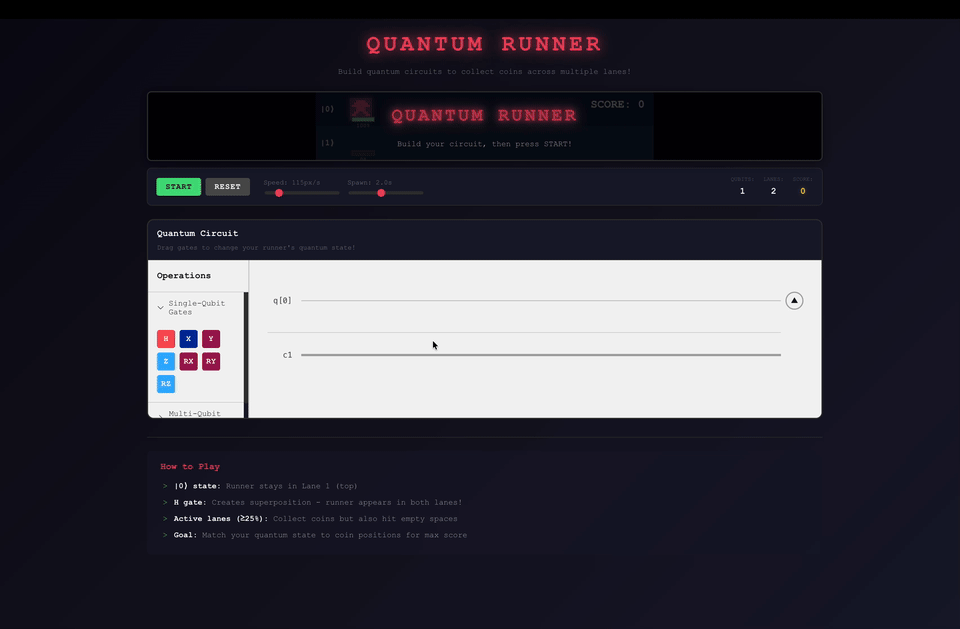

<h1 align="center">
  Qamposer
</h1>

<p align="center">
  <a href="https://qisk.it/e"></a>
  <a href="https://www.npmjs.com/package/@qamposer/react"></a>
  <a href="https://github.com/QAMP-62/qamposer-react/actions/workflows/ci.yml"></a>
  <a href="https://bundlejs.com/?q=@qamposer/react"></a>
  <a href="./LICENSE"></a>
</p>

Qamposer is a modular, open-source quantum composer that can be embedded into your applications and runs anywhere.

## Installation

```bash
npm install @qamposer/react
```

For the full version with visualization (Q-sphere, histograms), also install Plotly:

```bash
npm install plotly.js-basic-dist-min react-plotly.js
```

## Examples

### Educational Platform

**Suitable for quantum education in schools and companies.**

An interactive quantum computing tutorial with step-by-step guidance.



### Gaming Application

**Quantum Circuit as a Controller.**

Quantum mechanics and simulation results can be directly leveraged as game logic.



## Quick Start

### Basic Usage (QamposerMicro)

```tsx
import { QamposerMicro } from '@qamposer/react';

function App() {
  return <QamposerMicro />;
}
```

> **Note**: By default, QamposerMicro runs in editor-only mode (no simulation). To enable simulation, see [With Backend](#with-backend-simulation) below.

### Full Version with Visualization (Qamposer)

The full version includes visualization components (histograms, Q-sphere) that require simulation results, so a simulation adapter is needed. The zero-dependency `localAdapter` runs ideal simulation entirely in the browser — no server required:

```tsx
import { Qamposer } from '@qamposer/react/visualization';
import { localAdapter } from '@qamposer/react';

function App() {
  return <Qamposer adapter={localAdapter()} defaultTheme="dark" showThemeToggle />;
}
```

## Qamposer vs QamposerMicro

This library provides two preset components to fit different use cases:

| Feature              | Qamposer            | QamposerMicro               |
| -------------------- | ------------------- | --------------------------- |
| Circuit Editor       | Yes                 | Yes                         |
| Gate Library         | Yes                 | Yes                         |
| OpenQASM Code Editor | Yes                 | No                          |
| Results Histogram    | Yes                 | No                          |
| Q-Sphere (3D)        | Yes                 | No                          |
| Plotly.js Required   | Yes                 | **No**                      |
| Bundle Size          | Larger              | **Minimal**                 |
| Best For             | Full IDE experience | Embedded widgets, tutorials |

### When to use Qamposer

- Building a full-featured quantum circuit IDE
- Need visualization of simulation results (histograms, Q-sphere)
- Educational platforms where visualization is important

### When to use QamposerMicro

- Embedding in existing applications
- Tutorials and interactive documentation
- Games and lightweight applications
- When bundle size matters (no Plotly.js dependency)

## Backend Requirements

The React components work standalone for circuit editing. To run quantum simulations, you need the `qamposer-backend` server.

### Editor-Only Mode

By default, components run in editor-only mode without requiring a backend:

```tsx
import { QamposerMicro } from '@qamposer/react';

// No backend required - editor-only mode (default)
<QamposerMicro />;
```

### Local Simulation (no backend)

`localAdapter` runs ideal (noiseless) state-vector simulation entirely in the browser, with counts, seeded sampling, and Q-sphere data matching the backend's output format:

```tsx
import { QamposerMicro, localAdapter } from '@qamposer/react';

// No backend required — instant ideal simulation
<QamposerMicro adapter={localAdapter()} />;
```

Options:

```tsx
localAdapter({
  name: 'Browser Simulator', // display name
  maxQubits: 12, // reject wider circuits
  qsphere: true, // emit Q-sphere points for ≤5 qubits
});
```

It can also be combined with a backend adapter: the backend handles noisy fake devices via "Set up and run", while every circuit edit is simulated instantly in the browser:

```tsx
import { Qamposer } from '@qamposer/react/visualization';
import { qiskitAdapter, localAdapter } from '@qamposer/react';

<Qamposer
  adapter={qiskitAdapter(BACKEND_URL)} // noisy fake devices, via "Set up and run"
  realtimeAdapter={localAdapter()} // instant ideal results on every edit
/>;
```

### With Backend (Simulation)

Noisy fake-device simulation and [real hardware](#real-hardware-ibm-quantum) require the backend. Start it and pass the `qiskitAdapter`:

Assuming localhost is used here, but please specify the actual deployment destination for the backend.

```bash
# Clone and setup qamposer-backend
cd qamposer-backend
uv sync
uv run uvicorn backend.main:app --host 0.0.0.0 --port 8080 --reload
```

```tsx
import { QamposerMicro, qiskitAdapter } from '@qamposer/react';

<QamposerMicro
  adapter={qiskitAdapter('http://localhost:8080')}
  onSimulationComplete={(event) => {
    console.log('Result:', event.result);
    console.log('QASM:', event.qasm);
  }}
/>;
```

## API Reference

### Qamposer Props

```tsx
interface QamposerProps {
  // Circuit State
  circuit?: Circuit; // Controlled mode
  defaultCircuit?: Circuit; // Initial circuit
  onCircuitChange?: (circuit: Circuit) => void;
  onCircuitEdit?: (event: CircuitEditEvent) => void; // One event per edit, with its reason

  // Simulation
  adapter?: SimulationAdapter; // Backend adapter (default: noopAdapter)
  realtimeAdapter?: SimulationAdapter; // Auto-simulation on edit (default: adapter)
  onSimulationStart?: (event: SimulationStartEvent) => void;
  onSimulationComplete?: (event: SimulationCompleteEvent) => void;
  onSimulationError?: (event: SimulationErrorEvent) => void;
  onResultChange?: (event: ResultChangeEvent) => void; // Result shown or cleared
  onHardwareJobChange?: (job: HardwareJob | null) => void; // Real-hardware job updates

  // Configuration
  config?: QamposerConfig;

  // UI Customization
  className?: string;
  showHeader?: boolean; // Default: true
  title?: string; // Default: 'Qamposer'
  defaultTheme?: 'light' | 'dark'; // Default: 'dark'
  showThemeToggle?: boolean; // Default: true

  // Layout (Qamposer only)
  codeEditorWidth?: string; // Default: '280px'
  topGridTemplate?: string; // Default: '1fr 3fr'
  bottomGridTemplate?: string; // Default: '1fr 1fr'
}
```

### QamposerConfig

```tsx
interface QamposerConfig {
  maxQubits?: number; // Default: 5
  maxGates?: number; // Default: 500
  maxShots?: number; // Default: 10000
  realtimeShots?: number; // Shots for the automatic simulation on each edit. Default: 1024 (capped at maxShots)
}
```

### Simulation Events

Every simulation event carries `circuit`, `qasm`, and `source`: `'realtime'` for the automatic simulation on each edit, `'run'` for an explicit `simulate()` call (e.g. "Set up and run"), and `'hardware'` for a [real-hardware job](#real-hardware-ibm-quantum).

```tsx
<QamposerMicro
  adapter={localAdapter()}
  onSimulationStart={({ source }) => setLoading(true)}
  onSimulationComplete={({ result, source }) => source === 'run' && save(result)}
  onSimulationError={({ error }) => showToast(error.message)}
/>
```

To mirror the displayed result in your own UI, use `onResultChange`. It fires whenever `result` changes, including when it is cleared, which `onSimulationComplete` never reports:

```tsx
<QamposerMicro
  adapter={localAdapter()}
  config={{ realtimeShots: 4096 }}
  onResultChange={({ result, source, reason }) => {
    // reason: 'simulation' | 'empty-circuit' | 'clear' | 'remove-qubit'
    setCounts(result?.counts ?? null);
  }}
/>
```

Callbacks and adapters can be passed inline: the provider always calls the latest callback without re-running the simulation. Creating an adapter inline still re-checks `isAvailable()` on every parent render, so for network adapters prefer creating them once outside the component (or with `useMemo`).

### Adapter Availability

The provider checks the main `adapter` with `isAvailable()` on mount (for `qiskitAdapter`, a request to `/health`). The result is exposed as `adapterStatus`:

| `adapterStatus` | Meaning                                                         |
| --------------- | --------------------------------------------------------------- |
| `'checking'`    | The first check has not finished yet                            |
| `'available'`   | `simulate()` can run (`canSimulate` is `true`)                  |
| `'unavailable'` | The check returned `false` or failed (e.g. backend not running) |

`simulate()` is safe to call at any time:

- While `'checking'`, it waits for the check instead of failing, so calling it right after mount works.
- When `'unavailable'`, it checks once more, so a backend started after the page loaded is picked up without a reload.
- If the adapter is still unavailable, it rejects with `Simulation adapter is not available`, sets `status: 'error'` and `error`, and calls `onSimulationError` with `source: 'run'`.

The built-in "Set up and run" dialog shows **Connecting...** while checking, disables Run when the backend is unavailable, and shows a failed run inside the dialog. In `buttonOnly` mode, a failed run turns the button into **Retry** with the error as its tooltip.

```tsx
function RunButton() {
  const { simulate, adapterStatus } = useQamposer();
  return (
    <button disabled={adapterStatus === 'unavailable'} onClick={() => simulate().catch(showError)}>
      {adapterStatus === 'checking' ? 'Connecting...' : 'Run'}
    </button>
  );
}
```

### Real Hardware (IBM Quantum)

Circuits can run on IBM Quantum's real devices. Each user connects with **their own** IBM Quantum API key; jobs and QPU time are billed to their account. Enable it on the adapter (requires qamposer-backend with the `/api/ibm` endpoints):

```tsx
<Qamposer
  adapter={qiskitAdapter({ baseUrl: 'https://api.example.com', hardware: true })}
  realtimeAdapter={localAdapter()}
/>
```

In "Set up and run", users pick **IBM Quantum (real hardware)**, connect with their API key, choose a device (sorted by queue length), confirm that the job uses their QPU time, and submit. A status chip next to the button shows the job (queued / running, elapsed time, Cancel). Real devices are queued and can take minutes to hours, so jobs are polled in the background (5 s → 10 s → 30 s, slower in hidden tabs) and resumed after a page reload. The result replaces the display (`resultSource: 'hardware'`) only if the circuit is unchanged since submitting; otherwise it stays in `hardwareJob.result`.

**How the API key is handled**

| Where   | What happens                                                                                                                                                                            |
| ------- | --------------------------------------------------------------------------------------------------------------------------------------------------------------------------------------- |
| Browser | The key exists only in the password field until it is submitted, then the field is cleared. It is never stored (no localStorage / sessionStorage), never put in context, events or URLs |
| Network | Sent once over HTTPS in the body of `POST /api/ibm/session`                                                                                                                             |
| Server  | Validated with IBM (no QPU time used), encrypted with AES-256-GCM and kept for the session only (2 hours by default). Never logged or returned                                          |
| Session | The browser holds an opaque id in an `HttpOnly; Secure; SameSite=Strict` cookie that scripts cannot read. "Disconnect" deletes the server-side copy                                     |

**Requirements and recommendations**

- **Same site:** the session is a cookie, so the backend must be on the same site as the page (e.g. `example.com` + `api.example.com`) and served over HTTPS. Embeds on other sites (e.g. `*.github.io` with a backend elsewhere) cannot use real hardware.
- **Least-privilege keys:** ask users to create an API key for an IBM Cloud **service ID** that can only access their Qiskit Runtime instance, rather than their personal account key. They can revoke it in IBM Cloud at any time.
- **Content Security Policy:** on the hosting page, restrict `connect-src` to your backend to limit what injected scripts could reach.
- The backend limits job size and frequency (shots, one active job per session, rate limits); see qamposer-backend's `.env.example`.

Programmatic use goes through the same API:

```tsx
const { adapter, hardwareJob, submitHardwareJob, cancelHardwareJob } = useQamposer();

await adapter.hardware?.connect({ apiKey }); // the key is not kept after this call
const devices = await adapter.hardware?.listDevices(circuit.qubits);
await submitHardwareJob({ backend: devices[0].name, shots: 1024 });
// hardwareJob: { id, backend, status: 'queued' | 'running' | 'done' | 'error' | 'cancelled', result?, needsReconnect? }
```

If the session expires while a job is running, `hardwareJob.needsReconnect` becomes `true`. After the user connects again with the same key, `refreshHardwareJob()` picks the job up again.

### Controlling a Preset from Your App

Wrap a preset in your own `QamposerProvider` and use `useQamposer()` anywhere inside it. The preset uses the outer provider instead of creating its own, so your components share its state (`circuit`, `result`, `resultSource`, `status`, `error`) and actions (`setCircuit`, `importQasm`, `simulate`, `clearCircuit`, `addGate`, ...).

```tsx
import { QamposerProvider, QamposerMicro, useQamposer, localAdapter } from '@qamposer/react';

const adapter = localAdapter();

function Toolbar() {
  const { result, resultSource, setCircuit, importQasm, simulate } = useQamposer();
  return (
    <>
      <button onClick={() => setCircuit(PUZZLE_CIRCUIT)}>Load puzzle</button>
      {/* Actions see each other's changes, so this measures the imported circuit */}
      <button
        onClick={() => {
          importQasm(PUZZLE_QASM);
          simulate(1024);
        }}
      >
        Load & measure
      </button>
      <button onClick={() => simulate(1024)}>Measure</button>
      {/* resultSource: 'realtime' (auto-simulation on edit) or 'run' (simulate()) */}
      {result && resultSource === 'run' && <pre>{JSON.stringify(result.counts)}</pre>}
    </>
  );
}

function App() {
  return (
    <QamposerProvider adapter={adapter} onSimulationComplete={console.log}>
      <QamposerMicro />
      <Toolbar />
    </QamposerProvider>
  );
}
```

When a preset is inside a `QamposerProvider`, pass provider props (`adapter`, `circuit`, `onSimulationComplete`, ...) to the provider; the same props on the preset are ignored with a console warning. An outer `ThemeProvider` is reused in the same way.

### useQamposer() Reference

Available anywhere inside a `QamposerProvider` (including inside the presets). Editing actions take an optional last argument `{ origin }` (`'pointer' | 'keyboard' | 'code' | 'api'`, default `'api'`), reported in `onCircuitEdit`.

| State           | Description                                                                                      |
| --------------- | ------------------------------------------------------------------------------------------------ |
| `circuit`       | Current circuit                                                                                  |
| `result`        | Displayed simulation result, or `null`                                                           |
| `resultSource`  | What produced `result`: `'realtime'`, `'run'` or `'hardware'` (`null` without a result)          |
| `status`        | `'idle' \| 'simulating' \| 'error'`                                                              |
| `error`         | Last simulation error, or `null`                                                                 |
| `qasmCode`      | Text shown in the code editor                                                                    |
| `parseError`    | First QASM parse error of `qasmCode`, or `null`                                                  |
| `editingGate`   | Gate open in the gate editor, kept in sync with the circuit                                      |
| `canUndo`       | Whether `undo()` has something to undo                                                           |
| `canRedo`       | Whether `redo()` has something to redo                                                           |
| `canSimulate`   | `adapterStatus === 'available'`                                                                  |
| `adapterStatus` | `'checking' \| 'available' \| 'unavailable'` (see [Adapter Availability](#adapter-availability)) |
| `hardwareJob`   | The tracked real-hardware job, or `null` (see [Real Hardware](#real-hardware-ibm-quantum))       |
| `adapter`       | The main adapter                                                                                 |
| `config`        | Resolved `QamposerConfig` (defaults filled in)                                                   |

| Action                                         | Description                                                                                  |
| ---------------------------------------------- | -------------------------------------------------------------------------------------------- |
| `setCircuit(circuit)`                          | Replace the whole circuit (your gate ids are kept)                                           |
| `insertGate(placement, column)`                | Insert a gate, pushing overlapping gates right. Returns the new id (`null` at `maxGates`)    |
| `moveGate(gateId, { row, column })`            | Move a placed gate. For CNOT, `row` is the top-most row. Returns `false` if nothing changed  |
| `addGate(gate)`                                | Add a gate at its own `position` without shifting. Returns the new id                        |
| `removeGate(id)`                               | Remove a gate and left-compact the rest                                                      |
| `updateGate(id, updates)`                      | Change a gate's parameter or CNOT qubits (no-op if nothing changes)                          |
| `updateGates(gates)`                           | Replace all gates at once                                                                    |
| `setQubits(count)`                             | Set the qubit count (clamped to `1..maxQubits`)                                              |
| `addQubit()` / `removeQubit(index?)`           | Add a qubit / remove one (and the gates on it; default: the last qubit)                      |
| `clearCircuit()`                               | Remove all gates                                                                             |
| `undo()` / `redo()`                            | Step through the shared edit history                                                         |
| `importQasm(code)`                             | Load OpenQASM as a new circuit. Returns the parse result                                     |
| `setQasmCode(code)`                            | Edit as if typed in the code editor (keeps ids of untouched gates)                           |
| `exportQasm()`                                 | Current circuit as OpenQASM                                                                  |
| `setEditingGate(gate)`                         | Open (`gate`) or close (`null`) the gate editor                                              |
| `simulate(shots?, profile?)`                   | Run on the main adapter (see [Adapter Availability](#adapter-availability))                  |
| `submitHardwareJob({ backend, shots? })`       | Queue the current circuit on a real device (see [Real Hardware](#real-hardware-ibm-quantum)) |
| `cancelHardwareJob()` / `dismissHardwareJob()` | Cancel the queued/running job / stop tracking a finished one                                 |
| `refreshHardwareJob()`                         | Poll the job now (e.g. after reconnecting)                                                   |

### Editing Gates

Gates can be placed from the palette and moved after placement. Gates are always left-aligned, so moving a gate reorders it on its qubit or moves it to another qubit.

| Input    | Place a gate                                                                             | Move a placed gate                                      |
| -------- | ---------------------------------------------------------------------------------------- | ------------------------------------------------------- |
| Mouse    | Drag from the palette                                                                    | Drag the gate                                           |
| Touch    | Long-press a palette gate, then drag                                                     | Long-press the gate, then drag (a quick swipe scrolls)  |
| Keyboard | `1`-`7` (H, X, Y, Z, RX, RY, CNOT) or `Q` / `E` to cycle (includes RZ), `Space` to place | `Space` on a gate, arrow keys / `WASD`, `Space` to drop |

Drop outside the circuit or press `Esc` to cancel a drag. Every edit (pointer, keyboard, code editor, or API) goes into one undo history: `Ctrl/Cmd+Z` and `Ctrl/Cmd+Y` in the editor, or `undo()` / `redo()` from `useQamposer()`.

The same operations are available programmatically:

```tsx
const { insertGate, moveGate, removeGate, undo, redo, canUndo, canRedo } = useQamposer();

const id = insertGate({ type: 'H', qubit: 0 }, 0); // insert at column 0, pushing gates right
moveGate(id, { row: 1, column: 2 }); // for CNOT, row is the top-most row
```

### Circuit Edit Events

`onCircuitEdit` is called once per edit and says what changed and why. The gate the user acted on is `gateId`; gates that were pushed right or slid left as a side effect are listed separately in `displaced`, so a template can tell a user's move from a knock-on shift.

```tsx
<QamposerProvider
  onCircuitEdit={(event) => {
    // event.action: 'add' | 'move' | 'remove' | 'update' | 'undo' | 'redo'
    //   | 'add-qubit' | 'remove-qubit' | 'clear' | 'set' | 'import' | 'code'
    // event.origin: 'pointer' | 'keyboard' | 'code' | 'api'
    if (event.action === 'add' && event.origin !== 'api') {
      const gate = event.after.gates.find((g) => g.id === event.gateId);
      if (gate?.type === 'H' && gate.qubit === 0) goToNextStep();
    }
    if (event.action === 'move') {
      console.log(`${event.gateId} moved`, event.from, '→', event.to, 'displaced:', event.displaced);
    }
  }}
>
```

Every event carries two kinds of information:

| Kind                        | Fields                                                              | Present on                                                      | Use it for                      |
| --------------------------- | ------------------------------------------------------------------- | --------------------------------------------------------------- | ------------------------------- |
| **Intent** — why it changed | `action`, `origin`, `gateId`, `from` / `to`, `displaced`, `reverts` | `gateId` etc. only on single-gate edits; `reverts` on undo/redo | Reacting to what the user did   |
| **Result** — what changed   | `changes: { added, removed, updated, qubits? }`                     | Every action, including code edits, imports and undo            | Syncing state, scoring, logging |

`changes` matches gates by id and lists every gate whose state changed, including gates that were only pushed aside or renumbered. Use `action` and `gateId` (not `changes.updated`) to decide whether the user moved a gate.

```tsx
onCircuitEdit={({ action, reverts, changes }) => {
  if (action === 'undo' && reverts?.action === 'add') showHint('Undid the last gate');
  for (const gate of changes.added) track('gate-added', gate.type); // any source: palette, code, undo...
}}
```

- **Code editor:** typing in the QASM editor keeps the ids of gates the edit did not touch, so adding one line reports one added gate, and changing an angle reports an update of that gate. Code edits have no `gateId`: when identical gates sit next to each other (e.g. two `h q[0];`), which one was deleted cannot be known.
- **`importQasm`** is treated as loading a new circuit: all gates get new ids and `changes` reports a full replacement. Use `setCircuit` to replace a circuit while keeping your own ids.
- **Controlled mode:** when the parent replaces `circuit` itself, no event fires (the parent made the change). To compare circuits yourself, use the same logic via `diffCircuits(before, after)`.

> **Migrating from 0.2.x**
>
> - Gates are no longer dragged with the HTML5 Drag and Drop API (it does not work on touch devices). Code that dropped gates into the editor via `dataTransfer` should call `insertGate` instead.
> - `removeGate()` now left-compacts the remaining gates, like deleting from the editor.
> - `addGate()` now returns the new gate's id (or `null` at `maxGates`).
> - `editingGate` is tracked by id: it follows the circuit (undo, code edits) and becomes `null` when the gate is removed.
> - `simulate()` waits for the availability check instead of failing right after mount, and reports an unavailable adapter through `error` / `onSimulationError` as well as by rejecting.
> - `SimulationCompleteEvent` has a required `source` field. Code that constructs these events itself (e.g. in tests) must set it.
> - A preset inside your own `ThemeProvider` now uses it instead of creating its own.
> - `SimulationSource` (and `resultSource`) has a new value, `'hardware'`. Exhaustive `switch` statements over it need a new case.

<!-- ### Adapters

```tsx
// Qiskit Backend Adapter
import { qiskitAdapter } from '@qamposer/react';

const adapter = qiskitAdapter('http://localhost:8000');

// With options
const adapter = qiskitAdapter({
  baseUrl: 'http://localhost:8000',
  headers: { Authorization: 'Bearer token' },
  timeout: 30000,
});

// No-op Adapter (editor only, no simulation)
import { noopAdapter } from '@qamposer/react';
``` -->

<!-- ### Individual Components -->

<!-- You can also use components individually:

```tsx
import {
  CircuitEditor,
  Operations,
  CodeEditor,
  SimulationControls,
} from '@qamposer/react';

// Visualization components (require Plotly)
import { QSphereView, ResultsPanel } from '@qamposer/react/visualization';
``` -->

## OpenQASM Utilities

```tsx
import { circuitToQasm, qasmToCircuit } from '@qamposer/react';

// Convert Circuit to OpenQASM
const qasm = circuitToQasm(circuit);

// Parse OpenQASM to Circuit
const result = qasmToCircuit(qasmCode);
if (result.success) {
  console.log(result.circuit);
} else {
  console.error(result.errors);
}
```

## Supported Gates

| Gate | Description            | Parameters             |
| ---- | ---------------------- | ---------------------- |
| H    | Hadamard               | -                      |
| X    | Pauli-X (NOT)          | -                      |
| Y    | Pauli-Y                | -                      |
| Z    | Pauli-Z                | -                      |
| RX   | Rotation around X-axis | angle (radians)        |
| RY   | Rotation around Y-axis | angle (radians)        |
| RZ   | Rotation around Z-axis | angle (radians)        |
| CNOT | Controlled-NOT         | control, target qubits |

## Theming

The library uses CSS variables for theming. You can customize colors by overriding these variables:

```css
:root {
  --qamposer-bg-primary: #1a1a2e;
  --qamposer-bg-secondary: #16213e;
  --qamposer-text-primary: #ffffff;
  --qamposer-border: #2d3748;
  --qamposer-accent: #4fd1c5;
}
```

Or use the theme hook:

```tsx
import { useTheme } from '@qamposer/react';

function ThemeToggle() {
  const { theme, toggleTheme } = useTheme();
  return <button onClick={toggleTheme}>{theme}</button>;
}
```

## Peer Dependencies

```json
{
  "react": "^18.0.0 || ^19.0.0",
  "react-dom": "^18.0.0 || ^19.0.0"
}
```

For `Qamposer` (full version) with visualization:

```json
{
  "plotly.js-basic-dist-min": "^2.35.0 || ^3.0.0",
  "react-plotly.js": "^2.6.0"
}
```

## Support & Stability

- This library is under active development.
- Please report issues via [GitHub Issues](https://github.com/QAMP-62/qamposer-react/issues).

## License

Licensed under the Apache 2.0.
